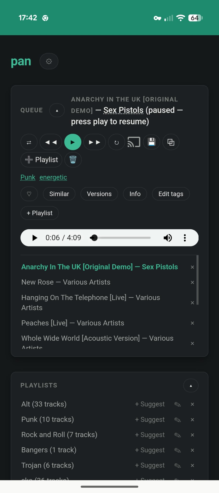

# pan

A self-hosted web app for a music library spread across a Plex server and a shared drive of
local files: AI-assisted search/tagging, a full in-browser player with Chromecast support, and
installable as a PWA — reachable just on the LAN, or from anywhere via the Tailscale deployment
below.




## Cataloging

- **Ingests** your catalog from Plex (`python-plexapi`) and scans a shared drive for anything
  Plex doesn't already know about, deduplicating by file path.
- **Tags** gaps in genre/mood: first for free using local audio-feature analysis
  (`librosa`: tempo/energy → mood), then via the Claude API for anything still missing,
  capped per run to control cost.
- **Searches** with natural language: simple queries run against a local embedding index
  (`sentence-transformers` + `sqlite-vec`, fully offline); queries with negation or
  multi-constraint logic ("upbeat but not metal", "before 1990") get parsed into a structured
  filter by Claude first, then combined with the embedding search.
- **Fixes itself**: edit genre/mood/tags/artist/title/album by hand (sticks permanently, never
  reverted by a later reindex), get an AI tag suggestion per track, or find everything still
  missing a usable title/artist via the "Needs attention" admin view.

## Listening

- **Plays** tracks in-browser with a persistent queue (shuffle/repeat, save-as-playlist,
  gapless prefetch of the next track), or casts to a **Chromecast** with its own volume and
  seek controls.
- **Remembers what you were listening to between devices** — pause on your phone, pick it back
  up on the desktop.
- **Playlists**, **favorites**, and **listening stats** (most/never played, most skipped,
  recently played/added) built from actual play events, not just a counter.
- Per-track **lyrics** (synced where available) and an AI-generated **"tell me more"**
  background writeup, both cached after first lookup.
- **Video mode**: toggle the queue to play a YouTube video instead of the local audio file,
  for whichever tracks have a match. Picks whichever of the top text-search results has a
  duration closest to the track's own known duration — any plausible mix/edit of the right song
  beats finding nothing, but this still rules out a wrong video entirely (a cover, a reaction
  video) landing closer by coincidence. Falls back to normal audio for any track without one.
  Needs `YOUTUBE_API_KEY` (optional; free Google Cloud key, YouTube Data API v3 enabled — see
  `.env.example`), looked up lazily per-track like lyrics,
  never backfilled in bulk (10,000 free quota units/day, a lookup costs 100 — roughly 100
  tracks/day).
- **Recommendations**: gap-fill (missing studio albums for artists you already love) and
  discovery (new adjacent artists) suggestions, refreshed each reindex from actual listening
  behavior (play count × completion rate, not just genre tags). Discovery is grounded in real
  Last.fm listener co-occurrence data when `LASTFM_API_KEY` is set (optional, also free),
  otherwise falls back to asking Claude directly. Viewable/downloadable from the admin panel.
- **Installable as a PWA** on a phone's home screen, with offline-friendly static assets via a
  service worker.

## Access

- LAN-only by default, or reachable from anywhere via the Tailscale-based NAS deployment below
  (no port-forwarding, no public exposure).
- Single-user HTTP Basic Auth (`PAN_AUTH_USER`/`PAN_AUTH_PASSWORD`) gates everything once the
  app is reachable beyond the LAN, except `/stream/*` (Chromecast's receiver can't send
  credentials, and that endpoint is LAN-trust-only regardless).

## Setup

```powershell
uv sync
copy .env.example .env
```

Edit `.env`:

- `PLEX_BASEURL` / `PLEX_TOKEN` — your Plex server URL and an auth token
  ([how to find your Plex token](https://support.plex.tv/articles/204059436-finding-an-authentication-token-x-plex-token/)).
  Leave blank to skip Plex entirely.
- `SHARED_DRIVE_PATH` — folder to scan for local audio files not in Plex. Leave blank to skip.
- `ANTHROPIC_API_KEY` — enables cloud tagging fallback and complex query parsing. Without it,
  tagging stops after the local pass and search falls back to plain semantic matching.
- `CLOUD_TAGGING_MAX_PER_RUN` — safety cap on how many tracks get sent to Claude per reindex.

## Running

```powershell
make install   # uv sync
make reindex   # pull Plex + shared drive, extract features, tag, build search index
make run       # start the web app at http://localhost:8000
```

Or trigger a reindex from the UI itself ("Reindex library" button) — it runs in the
background and the button shows progress.

## Testing

```powershell
make test
```

Unit tests cover ingest merge/dedupe and the local tagging heuristics without hitting Plex,
the filesystem, or the Claude API.

## Known limitations

- **Playback**: only tracks with a locally-reachable file path can be streamed in the browser
  player. Plex-only tracks (no accessible file path from this machine) show up in search but
  aren't playable yet — adding direct-play via Plex's streaming API is a natural next step.
- **Audio feature extraction** only runs for tracks whose file is reachable from this machine;
  Plex tracks are only feature-analyzed if their underlying file path also resolves locally
  (e.g. the Plex library and the shared drive are the same mount).

## Deploying elsewhere

### Synology NAS, reachable outside the LAN via Tailscale

`docker-compose.yml` runs `pan` alongside a `tailscale` sidecar container, so the app gets a
private HTTPS address on your tailnet (`https://pan.<your-tailnet>.ts.net`) reachable from your
phone or laptop from anywhere — no port-forwarding, no public exposure. Tailscale terminates
TLS with a real (not self-signed) cert, so none of the LAN-only `certs/`/`make run` setup is
needed for this path.

1. Install **Container Manager** from Synology Package Center (DSM 7+) if not already present.
2. In the [Tailscale admin console](https://login.tailscale.com/admin/settings/keys), generate
   a reusable auth key.
3. Create an empty `tailscale-state` folder next to `docker-compose.yml` on the NAS before the
   first build — Synology's Docker doesn't auto-create bind-mount directories that don't
   already exist, unlike most Docker setups, and the build fails with "Bind mount failed" if
   it's missing.
4. Copy this repo onto the NAS. If you're using File Station rather than `git clone` over SSH,
   zip/archive it with something that writes POSIX-style forward-slash paths (`tar`, 7-Zip) —
   PowerShell's `Compress-Archive` writes backslashes into zip entries on Windows, which
   Synology's (Linux) extractor treats as literal characters in a filename instead of a
   directory separator, silently flattening `backend/app.py` into a file named
   `backend\app.py` sitting at the top level. `docker build` then fails with something like
   `COPY failed: file not found in build context: stat backend: file does not exist`.
5. `cp .env.example .env` and fill it in:
   - The usual Plex/shared-drive/Claude vars.
   - `SHARED_DRIVE_PATH=/music` — the path as `pan` sees it *inside the container* (not the
     NAS host path). Keep this `.env` separate from any local dev `.env` you have elsewhere —
     the same variable name means a different thing in each.
   - `NAS_MUSIC_PATH=/volume1/music` (or wherever your music actually lives on the NAS) — the
     host-side path `docker-compose.yml` bind-mounts to `/music`.
   - `TS_AUTHKEY=` the key from step 2.
   - `PAN_AUTH_USER` / `PAN_AUTH_PASSWORD` — required for this path (see above): once `pan` is
     reachable beyond the LAN, nothing else stops a visitor from browsing your library or
     triggering a Claude-billed reindex.
6. Build and start, either via Container Manager's "Project" import or over SSH:

   ```sh
   docker compose up -d --build
   ```

   The `tailscale` service runs in **userspace networking mode** (`TS_USERSPACE=true` in
   `docker-compose.yml`) rather than the usual kernel TUN device — some Synology models don't
   expose `/dev/net/tun` to Docker at all, and userspace mode works fine for this setup since we
   only need inbound access via `tailscale serve` to a localhost port, not full tailnet routing
   (no downside here, but it's why the compose file looks different from most Tailscale sidecar
   examples you'll find online). Pin the image to `tailscale/tailscale:stable` rather than
   `:latest` — `:latest` has a window where Docker Hub is mid-rebuild and pulling it fails with
   "no matching manifest", which otherwise looks like an architecture mismatch but usually isn't.
7. Point the app at a tailnet HTTPS address — first time only, since the exact MagicDNS domain
   (`pan.<your-tailnet>.ts.net`) isn't known until the node registers:

   ```sh
   docker compose exec tailscale tailscale serve --bg http://127.0.0.1:8000
   docker compose exec tailscale tailscale serve status   # prints the https://pan.<tailnet>.ts.net URL
   ```

   This alone does **not** survive the `pan`/`tailscale` containers being recreated (torn down
   and rebuilt, not just restarted) — only the tailnet identity persists via the `tailscale-state`
   volume, not the serve routing. Make it permanent instead: run
   `docker compose exec tailscale tailscale serve status --json`, save that output as
   `tailscale-config/serve.json` (already present in this repo, with the domain above baked in —
   update it if your tailnet name differs), and `docker-compose.yml` sets
   `TS_SERVE_CONFIG=/config/serve.json` so it's reapplied automatically on every container start
   from here on, with no manual step.
8. Install [Tailscale](https://tailscale.com/download) on your phone/laptop and sign in to the
   same tailnet. The URL from step 7 now works from anywhere, not just the LAN.

Chromecast casting still only works on the LAN (Cast discovery is LAN-multicast and the
receiver hardware can't authenticate anyway) — unaffected by any of this, since `/stream/*` is
exempt from the auth gate and the sidecar doesn't change how the NAS sits on your home network.

**Updating the deployed app**: don't just re-extract a fresh copy of everything — `pan.db` and
`.env` on the NAS are now the live state (play counts, favorites, Chromecast history, your
filled-in secrets), and your local copies of those two files are stale forks of them. Only
redeploy code/config (`backend/`, `ui/`, `scripts/`, `Dockerfile`, `docker-compose.yml`,
`pyproject.toml`, `uv.lock`), and in Container Manager use the project's explicit **Build**
action afterward, not just Start/Restart — restarting alone reuses the already-built image and
won't pick up source changes.

### Plain Docker, LAN-only

The `Dockerfile` alone also works standalone — `docker build` it and mount your shared drive +
a volume for `pan.db`, passing the same env vars as `.env`, if you just want it on the LAN
without remote access.
